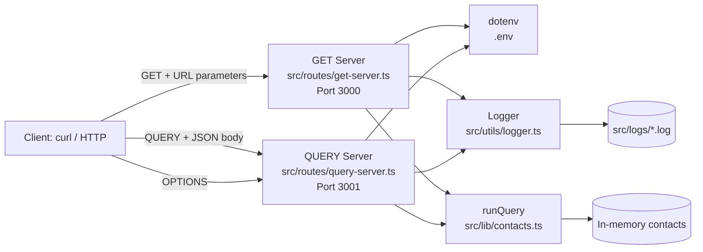

<div align="center">

# 🌐 HTTP GET vs. QUERY Demo

### TypeScript · Node.js · RFC 10008 · HTTP Observability · Bash

[](https://github.com/CryptoKingXavier/http-proxy)
[](https://nodejs.org/)
[](https://www.typescriptlang.org/)
[](https://www.npmjs.com/)
[](https://www.npmjs.com/package/dotenv)
[](https://tsx.is/)
[](https://www.gnu.org/software/bash/)
[](https://curl.se/)
[](https://opensource.org/licenses/MIT)
[](https://github.com/CryptoKingXavier/http-proxy/stargazers)
[](https://github.com/CryptoKingXavier/http-proxy/network/members)

**A local HTTP demonstration comparing conventional `GET` queries with the experimental body-based `QUERY` method.**

</div>

> [!IMPORTANT]
> Despite the repository name, this project is **not** an HTTP forward or reverse proxy.
> It is a learning demonstration that exposes a shared, in-memory contact-search
> implementation through two native Node.js HTTP servers.

---

## 📚 Table of Contents

- [🔎 Overview](#-overview)
- [✨ Features](#-features)
- [🧰 Technology Stack](#-technology-stack)
- [🏗️ Architecture](#️-architecture)
- [✅ Requirements](#-requirements)
- [🚀 Quick Start](#-quick-start)
- [⚙️ Environment Configuration](#️-environment-configuration)
- [🖥️ Running the Servers](#️-running-the-servers)
- [🌐 HTTP API](#-http-api)
- [🧠 Shared Query Behavior](#-shared-query-behavior)
- [📊 Logging and Observability](#-logging-and-observability)
- [🧪 Bash Demos](#-bash-demos)
- [🗂️ Project Structure](#️-project-structure)
- [📦 npm Scripts](#-npm-scripts)
- [🛠️ Development and Validation](#️-development-and-validation)
- [🩹 Troubleshooting](#-troubleshooting)
- [🔐 Limitations and Security](#-limitations-and-security)
- [🗺️ Roadmap](#️-roadmap)
- [🤝 Contributing](#-contributing)
- [📄 License](#-license)

---

## 🔎 Overview

This repository explores two ways to search the same static contact collection:

| Demo | HTTP method | Route | Query location |
| --- | --- | --- | --- |
| 🟩 GET demonstration | `GET` | `http://localhost:3000/contacts` | URL query parameters |
| 🟦 QUERY demonstration | `QUERY` | `http://localhost:3001/contacts` | JSON request body |

Both servers call [`runQuery`](./src/lib/contacts.ts), so differences are about
HTTP transport, validation, discovery, and logging rather than unrelated search
implementations.

The QUERY server demonstrates concepts associated with RFC 10008:

- `QUERY` carries structured data in a request body.
- A resource advertises support with `OPTIONS`.
- The server declares accepted query media types with `Accept-Query`.
- The request is rejected for a missing or unsupported `Content-Type`.
- Malformed JSON or an invalid query shape returns `422`.

This is an experimental protocol demonstration. It is not a complete RFC
conformance implementation or a production-ready HTTP service.

---

## ✨ Features

- 🟩 Side-by-side **GET** and **QUERY** contact search demonstrations
- 🧮 Case-insensitive substring matching across surname and email
- 🔢 Optional result limits with finite-number and floor/clamping handling
- 🎯 Optional field selection for `surname` and `email`
- 📦 Shared in-memory contacts and query logic
- 🌐 JSON responses under a consistent `{ "results": [...] }` envelope
- 🧾 Mandatory `Content-Type` validation for QUERY requests
- 🚫 Clear `400`, `415`, and `422` error paths
- 🧭 `OPTIONS` capability discovery with `Allow` and `Accept-Query`
- 🪪 Request UUIDs exposed through the `X-Request-ID` response header
- 📊 Detailed pretty-text or JSON HTTP access logging
- 🔐 Allowlisted request-header logging to avoid credentials and cookies
- ⚙️ Environment-variable port and Node environment configuration
- 🐚 Bash scripts for server lifecycle, curl demonstrations, and cleanup

---

## 🧰 Technology Stack

| Technology | Badge | Purpose |
| --- | --- | --- |
| 🟩 Node.js |  | Runtime, native HTTP server, streams, crypto UUIDs, and filesystem APIs |
| 🟦 TypeScript |  | Typed models, validators, and server implementation |
| ⚡ tsx |  | Executes TypeScript source without a separate build step |
| 📦 npm |  | Dependency installation and project scripts |
| 🌱 dotenv |  | Loads `GET_PORT`, `QUERY_PORT`, and `NODE_ENV` |
| 🐚 Bash |  | Starts servers, executes curl checks, and cleans up processes |
| 🌐 curl |  | Sends GET, QUERY, and OPTIONS requests |
| 📝 MIT License |  | Permissive open-source license |
| 🐙 GitHub |  | Source repository, issues, releases, and collaboration |

### Runtime Dependencies

| Package | Version | Role |
| --- | --- | --- |
| `dotenv` | `^18.0.10` | Loads values from `.env` |

### Development Dependencies

| Package | Version | Role |
| --- | --- | --- |
| `tsx` | `^4.23.15` | Development TypeScript runner |
| `typescript` | `^7.0.2` | Strict type checking |
| `@types/node` | `^26.6.6` | Node.js API type definitions |

No web framework, database, container runtime, frontend framework, or separate
build tool is required.

---

## 🏗️ Architecture



### Request Flow

#### GET request

1. A request reaches the native Node.js server on port `3000`.
2. The logger initializes and registers lifecycle monitoring.
3. The server verifies `/contacts` and the `GET` method.
4. URL parameters are parsed into a `ContactQuery`.
5. `runQuery` filters and shapes the static contact list.
6. JSON is returned beneath a `results` property.
7. The logger records a request-complete access entry.

#### QUERY request

1. A request reaches the native Node.js server on port `3001`.
2. The logger initializes and registers lifecycle monitoring.
3. `OPTIONS` requests return capability headers; all other routes are checked.
4. `Content-Type` must exist and equal `application/json`.
5. The body is fully read and parsed.
6. The object shape is validated.
7. `runQuery` executes and returns the shaped result.
8. The logger records status, timing, connection, and response details.

---

## ✅ Requirements

### Required

- **Node.js 21.7.2 or newer**  
  The source specifically notes this as the minimum for Node's llhttp parser
  support for the `QUERY` method. A currently supported Node.js LTS release,
  preferably Node.js 22 or newer, is recommended.
- **npm**
- **Two available local ports:** `3000` and `3001`

### Bash Demo Requirements

- Bash
- `curl`
- Unix-style process utilities used by the demo:
  - `pkill`
  - `kill`
  - `fuser` or `lsof`

The Bash scripts are best suited to Linux, macOS, WSL, or Git Bash. The direct
npm servers can be run on any platform supported by Node.js.

Verify tooling:

```bash
node --version
npm --version
curl --version
bash --version
```

---

## 🚀 Quick Start

```bash
git clone https://github.com/CryptoKingXavier/http-proxy.git
cd http-proxy
npm ci
```

Copy or verify `.env` in the repository root:

```dotenv
GET_PORT=3000
QUERY_PORT=3001
NODE_ENV="development"
```

Start both servers directly with `tsx`:

```bash
npx tsx ./src/routes/get-server.ts
```

In another terminal:

```bash
npx tsx ./src/routes/query-server.ts
```

Alternatively, run the complete Bash demonstration:

```bash
bash ./linux/demo-server.sh
```

The demo script starts both servers, performs successful and negative curl
checks, prints capability headers, and then shuts the demo processes down.

---

## ⚙️ Environment Configuration

The repository includes a root [`.env`](./.env) file.

| Variable | Used by | Default | Purpose |
| --- | --- | --- | --- |
| `GET_PORT` | [`get-server.ts`](./src/routes/get-server.ts) | `3000` | GET server listen port |
| `QUERY_PORT` | [`query-server.ts`](./src/routes/query-server.ts) | `3001` | QUERY server listen port |
| `NODE_ENV` | Environment/demos | `development` | Documents the current runtime mode |

The GET server explicitly resolves `../../.env` relative to
`src/routes/get-server.ts`. The QUERY server uses `import "dotenv/config"`,
which loads the root `.env` based on the process working directory.

Ports are parsed with `Number(...) || fallback`. A missing or invalid variable
falls back to `3000` or `3001`.

> [!WARNING]
> `.env` is ignored by Git through [`.gitignore`](./.gitignore). The checked-in
> file is local configuration and should not contain production secrets.

---

## 🖥️ Running the Servers

### GET Server

```bash
npx tsx ./src/routes/get-server.ts
```

Server:

```text
http://localhost:3000/contacts
```

Example:

```bash
curl "http://localhost:3000/contacts?match=example.com&limit=2&select=surname,email"
```

### QUERY Server

```bash
npx tsx ./src/routes/query-server.ts
```

Server:

```text
http://localhost:3001/contacts
```

Example:

```bash
curl -X QUERY "http://localhost:3001/contacts" \
  -H "Content-Type: application/json" \
  -d '{
    "match": "example.com",
    "limit": 2,
    "select": ["surname", "email"]
  }'
```

Stop either server with `Ctrl+C`.

---

## 🌐 HTTP API

### Sample Response

Both servers return a JSON envelope:

```json
{
  "results": [
    {
      "surname": "Lovelace",
      "email": "ada@example.com"
    },
    {
      "surname": "Hopper",
      "email": "grace@example.com"
    }
  ]
}
```

### 🟩 `GET /contacts`

```bash
curl "http://localhost:3000/contacts?match=example&limit=2&select=surname,email"
```

| Parameter | Type | Behavior |
| --- | --- | --- |
| `match` | URL string | Case-insensitive substring match across surname and email |
| `limit` | URL string | Converted with `Number`; finite values are floored and clamped |
| `select` | URL string | Comma- or period-separated field names |

`select=surname,email` and `select=surname.email` are both split into field
names. Recognized fields are `surname` and `email`.

| Condition | Status |
| --- | --- |
| Valid GET request | `200 OK` |
| Unknown route | `404 Not Found` |
| Method other than GET | `405 Method Not Allowed` |

### 🟦 `QUERY /contacts`

The request body must be a JSON object:

```json
{
  "match": "example.com",
  "limit": 2,
  "select": ["surname", "email"]
}
```

| Field | Required | Type | Behavior |
| --- | --- | --- | --- |
| `match` | No | `string` | Case-insensitive substring match |
| `limit` | No | finite `number` | Maximum number of contacts; floored and clamped |
| `select` | No | `string[]` | Requested output fields |

#### Missing `Content-Type`

```bash
curl -X QUERY "http://localhost:3001/contacts" \
  -d '{"match":"example.com"}'
```

Expected status:

```text
400 Bad Request
```

#### Unsupported `Content-Type`

```bash
curl -X QUERY "http://localhost:3001/contacts" \
  -H "Content-Type: text/plain" \
  -d 'match=example.com'
```

Expected status:

```text
415 Unsupported Media Type
Accept-Query: application/json
```

#### Invalid JSON

```bash
curl -X QUERY "http://localhost:3001/contacts" \
  -H "Content-Type: application/json" \
  -d '{invalid-json'
```

Expected status:

```text
422 Unprocessable Content
```

#### Invalid Query Shape

```bash
curl -X QUERY "http://localhost:3001/contacts" \
  -H "Content-Type: application/json" \
  -d '{"limit":"two"}'
```

The server requires `limit` to be a finite number when provided.

### 🧭 Capability Discovery

```bash
curl -i -X OPTIONS "http://localhost:3001/contacts"
```

An active resource returns:

```text
HTTP/1.1 204 No Content
Allow: QUERY, OPTIONS
Accept-Query: application/json
```

### Status Summary

| Condition | Status | Important headers |
| --- | ---: | --- |
| Unknown route | `404` | — |
| Unsupported method | `405` | `Allow: QUERY, OPTIONS` and/or `Allow: GET` |
| Missing QUERY content type | `400` | — |
| Unsupported QUERY media type | `415` | `Accept-Query: application/json` |
| Invalid JSON or query shape | `422` | — |
| Successful QUERY | `200` | `Content-Type: application/json`, `Accept-Query: application/json` |
| Successful OPTIONS | `204` | `Allow: QUERY, OPTIONS`, `Accept-Query: application/json` |

---

## 🧠 Shared Query Behavior

The shared [`runQuery`](./src/lib/contacts.ts) function operates on this static
contact collection:

| Surname | Email |
| --- | --- |
| Lovelace | `ada@example.com` |
| Hopper | `grace@example.com` |
| Turing | `alan@computing.example` |
| Hamilton | `margaret@software.example` |

Rules:

1. If `match` is omitted or `undefined`, every contact is eligible.
2. Matching is case-insensitive and tests surname and email substrings.
3. Finite numeric limits are floored and clamped to at least zero.
4. A negative limit therefore produces an empty result.
5. Omitting `select` returns both fields.
6. With `select`, only recognized `surname` and `email` names are retained.
7. The shared implementation is stateless and does not mutate the contact array.

The query model also supports exact optional-property types through TypeScript:

```typescript
export type ContactQuery = {
  match?: string | undefined;
  limit?: number | undefined;
  select?: string[] | undefined;
};
```

---

## 📊 Logging and Observability

Both servers use [`src/utils/logger.ts`](./src/utils/logger.ts), a native
Node.js HTTP observability logger.

### Default Logger Behavior

| Setting | Default |
| --- | --- |
| Log level | `DEBUG` |
| Destination | `both` |
| Format | `pretty` |
| Directory | `src/logs` for both servers |
| Query logging | Disabled |
| Request UUID headers | Enabled |
| User agent/IP logging | Enabled |
| Directory creation | Enabled |

Each server creates a dedicated file:

- [`src/logs/get-server.log`](./src/logs/get-server.log)
- [`src/logs/query-server.log`](./src/logs/query-server.log)

### Logged Information

The access logger includes:

- UUID request IDs
- Timestamp and HTTP method
- URL/path/host/hostname
- Optional query-string data
- HTTP version and protocol
- IP address and remote port
- User agent and common accept headers
- Allowlisted safe request headers
- Response status, content type, and socket state
- Duration in milliseconds
- Socket byte counters
- Keep-alive state
- Captured request/response errors
- Connection-aborted detection

The logger automatically sets:

```text
X-Request-ID: <UUID>
```

It deliberately excludes authorization, cookie, and set-cookie headers from
safe request metadata.

### Safe Data Behavior

The default query-string setting is `includeQuery: false`, so the
`GET /contacts?match=...` query is normally excluded from ordinary access
records. Enable `includeQuery` only if the logged application can safely retain
the URL parameters.

File writes are ordered through an in-memory promise queue. `logger.flush()`
waits for queued writes before the process continues.

---

## 🧪 Bash Demos

### Full HTTP Demo

[`linux/demo-server.sh`](./linux/demo-server.sh) is the interactive end-to-end
demonstration.

```bash
bash ./linux/demo-server.sh
```

It:

1. Starts the GET and QUERY servers with local `tsx` binaries.
2. Polls both ports before displaying readiness.
3. Runs a GET example.
4. Runs an equivalent QUERY example.
5. Checks missing and unsupported content types.
6. Checks malformed JSON.
7. Requests OPTIONS capability headers.
8. Attempts to terminate spawned servers and orphaned port users.

### Long-Running Server Demo

[`linux/server.sh`](./linux/server.sh) starts both servers and waits for their
ports without running curl demonstrations.

```bash
bash ./linux/server.sh
```

Stop it with `Ctrl+C`. Its cleanup trap terminates both server processes.

### Server Output

The scripts send process output to `/dev/null` because request output is written
to the configured application log files instead. The server startup banner and
demo output remain visible in the terminal.

---

## 🗂️ Project Structure

```text
http-proxy/
├── .env                       # Local GET_PORT, QUERY_PORT, NODE_ENV
├── .gitignore                 # Node, Windows, logs, IDE, and environment ignores
├── LICENSE                    # MIT license
├── README.md                  # Project documentation
├── package.json               # Package metadata and scripts
├── package-lock.json          # Reproducible npm dependency lock
├── tsconfig.json              # Strict TypeScript/Nodenext configuration
├── linux/
│   ├── demo-server.sh         # End-to-end curl demonstrations
│   └── server.sh              # Start both servers and wait
└── src/
    ├── lib/
    │   ├── CMDS               # Initial setup/download commands
    │   └── contacts.ts        # Contact types and shared query implementation
    ├── logs/
    │   ├── get-server.log     # GET access logs
    │   └── query-server.log   # QUERY access logs
    ├── routes/
    │   ├── get-server.ts      # GET /contacts server on port 3000
    │   └── query-server.ts    # QUERY /contacts server on port 3001
    └── utils/
        └── logger.ts          # Native HTTP observability logger
```

---

## 📦 npm Scripts

| Command | Configured command | Status |
| --- | --- | --- |
| `npm run start:get` | `tsx get-server.ts` | ⚠️ Stale: file is now [`src/routes/get-server.ts`](./src/routes/get-server.ts) |
| `npm run start:query` | `tsx query-server.ts` | ⚠️ Stale: file is now [`src/routes/query-server.ts`](./src/routes/query-server.ts) |
| `npm run demo` | `bash demo-server.sh` | ⚠️ Stale: script is now [`linux/demo-server.sh`](./linux/demo-server.sh) |
| `npm run server` | `bash server.sh` | ⚠️ Stale: script is now [`linux/server.sh`](./linux/server.sh) |
| `npm run typecheck` | `tsc --noEmit` | ✅ Type-check script |
| `npm test` | Placeholder exit | ⚠️ No automated test suite |

Use the direct commands documented in this README until package scripts are
updated.

---

## 🛠️ Development and Validation

### Install Dependencies

```bash
npm ci
```

### Type Check

```bash
npm run typecheck
```

The TypeScript configuration enables:

- ECMAScript modules
- NodeNext module resolution
- `target: esnext`
- `.ts` import support
- Strict mode
- Exact optional property types
- No unchecked indexed access
- Verbose module detection
- No emitted JavaScript

### Manual HTTP Validation

Start the servers:

```bash
npx tsx ./src/routes/get-server.ts
npx tsx ./src/routes/query-server.ts
```

Exercise success and failure cases:

```bash
curl "http://localhost:3000/contacts?match=example&limit=2"
curl -X OPTIONS "http://localhost:3001/contacts" -i
curl -X QUERY "http://localhost:3001/contacts" \
  -H "Content-Type: application/json" \
  -d '{"match":"example","limit":2,"select":["surname","email"]}'
curl -X QUERY "http://localhost:3001/contacts" \
  -H "Content-Type: application/json" \
  -d '{invalid-json'
```

### Test Status

The repository does not currently contain:

- A unit-test framework
- Integration test assertions
- Coverage configuration
- CI workflows
- An HTTP server test harness
- A build/distribution command

`npm test` is only a placeholder and should not be used as a validation result.

---

## 🩹 Troubleshooting

### `EADDRINUSE`

A process is already using port `3000` or `3001`.

```bash
# Linux/macOS
lsof -i :3000
lsof -i :3001
```

Stop the conflicting process or change `.env` to new available ports.

### QUERY Is Not Recognized

- Verify Node.js is 21.7.2 or newer; Node.js 22+ is recommended.
- Confirm the method is exactly `QUERY`.
- Confirm `Content-Type: application/json`.
- Send a JSON object, not an array or primitive.

### The Server Cannot Find `.env`

Run both servers from the repository root:

```bash
cd http-proxy
npx tsx ./src/routes/get-server.ts
```

The GET server has an explicit relative `.env` resolution. The QUERY server
also imports dotenv configuration.

### Logs Are Missing

The logger creates `src/logs` automatically. Ensure the process can write in
the repository directory.

### Bash Script Shows a 404 While Waiting

The readiness loop can receive `/` requests because it only waits for the server
socket to respond. Port readiness is valid even though `/` itself is a `404`
when it is not one of the defined routes.

### npm Server Scripts Fail

The four server/demo scripts in `package.json` have stale paths:

```bash
npx tsx ./src/routes/get-server.ts
npx tsx ./src/routes/query-server.ts
bash ./linux/demo-server.sh
bash ./linux/server.sh
```

---

## 🔐 Limitations and Security

- This is a demonstration, not a production reverse or forward proxy.
- There is no authentication or authorization.
- There is no TLS/HTTPS implementation.
- There is no CORS policy.
- There is no request-body size limit.
- The QUERY body is buffered fully into memory.
- The contact store is static and not persistent.
- The server does not implement routing middleware or a framework.
- It does not provide structured API schema generation.
- Logging is local and has no rotation or external log shipping.
- The Bash cleanup script may terminate processes associated with demo ports;
  run it only in a dedicated development environment.
- The repository name and package description use “proxy”, but no forwarding
  destination or proxy behavior exists.
- Logger query logging is disabled by default to avoid accidental sensitive
  URL parameter retention.

---

## 🗺️ Roadmap

Potential follow-up improvements:

- [ ] Repair stale npm scripts for the current `src/` and `linux/` layout
- [ ] Add Jest, Node test runner, Vitest, or another test framework
- [ ] Add integration tests for GET, QUERY, OPTIONS, and error responses
- [ ] Make ports and host names fully configurable
- [ ] Add request-body size limits
- [ ] Add graceful shutdown handling
- [ ] Add log rotation and configurable logger destinations
- [ ] Add CI for type-checking and HTTP integration tests
- [ ] Add Docker or Dev Container support
- [ ] Add formal OpenAPI or API description metadata
- [ ] Remove or clarify proxy wording if the project remains educational

---

## 🤝 Contributing

Contributions are welcome for documentation, protocol demonstrations, tests,
logging improvements, and script reliability.

Before submitting a change:

1. Fork the repository on GitHub.
2. Create a descriptive feature branch.
3. Keep GET and QUERY behavior aligned through `src/lib/contacts.ts`.
4. Run:

   ```bash
   npm ci
   npm run typecheck
   bash ./linux/demo-server.sh
   ```

5. Update documentation for new paths, scripts, ports, fields, headers, or
   environment variables.
6. Open a pull request with the observed behavior and test results.

---

## 📄 License

This project is licensed under the **MIT License**.

See [`LICENSE`](./LICENSE) for the complete terms.

<div align="center">

**[⬆ Back to top](#-http-get-vs-query-demo)**

[](https://github.com/CryptoKingXavier/http-proxy)
[](./LICENSE)

</div>
